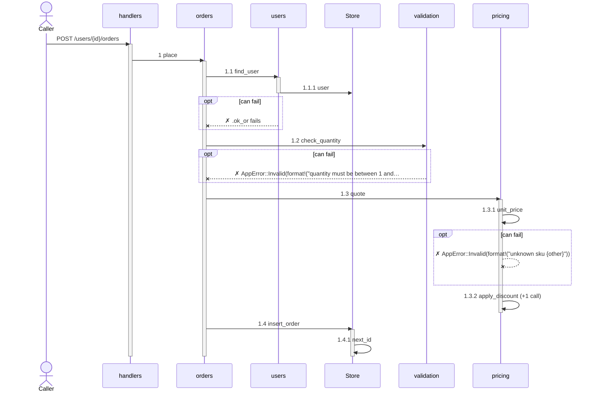

# codeviz

Explore a Rust codebase's call flow in 3D. Point it at a directory, pick a function
(an Axum handler, say), and follow everything it calls.

```sh
mise install
mise run demo-docs                   # regenerate the demo IR documents
mise run demo                        # 3D view of the Rust demo
mise run demo-merged                 # architecture + Rust code as one system
mise run demo-diff                   # the Rust demo after a change, diffed

codeviz analyze <dir> -o app.json    # Rust or Python source → IR
codeviz analyze <dir> --resolve syntax   # skip rust-analyzer: fast, guesses method calls
codeviz import pipeline.yml -o ci.json
codeviz validate app.json
codeviz journey app.json             # list entries
codeviz journey app.json -e 'POST /users/{id}/orders' -s 2   # one scenario as text
codeviz journey app.json -e 'POST /users/{id}/orders' --format md --depth 2   # to paste
codeviz journey app.json -e 'POST /users/{id}/orders' --format mermaid        # a diagram
codeviz view app.json other.json     # merged 3D view
codeviz view new.json --before old.json   # what changed, over the graph
codeviz diff main...HEAD             # a branch as its pull request shows it
codeviz diff HEAD -C crates/foo      # uncommitted changes in one crate
codeviz diff v1..v2 --summary        # print the changes instead
codeviz diff main...HEAD --summary md   # the changes, as Markdown for the pull request
```

The codebase floats as a graph, one node per function, each module gathered in its own
ring. Click a node and the camera orbits it, and its journey opens docked as a flame
graph: what it calls directly first, numbered `1`, `2`, … on its bars and on the graph's
labels alike. `,`/`.` show a level less or more, a bar's `+N` opens the calls folded
under it, and `V` switches to showing calls only as the cursor reaches them. A closure
counts as part of the function around it.

Each color says one thing. A link's color says which way a call runs: violet into the
focus, blue out of it, with dots flowing along it. A node's fill says where it lives,
its module, the same color as its ring; under a diff it says what changed instead. A
journey bar is filled exactly like its node, and its number sits on a badge of that
color beside the node, so a bar finds its node at a glance; hovering a bar draws a line
to it. `I` picks out everything that calls the focus and `O` everything it calls,
pulling the camera back only as far as it takes to show them all.

Digits walk to the focus's nth call, shift+digit to its nth caller, `-` and `=` reveal
less or more around a starting point, the focus, a diff's changes or the active
journey (`L` switches), measured in calls, distance in the graph, or a blend of both
(`G` switches); what is out of reach dims, then shrinks to a speck. `Q` jumps between
everything, two steps and one. In the journey, `←`/`→` move between calls by the same
caller, `↓`/`↑` go in and out, `[`/`]` step through time. `/` searches for a function,
`S` opens the side panel (the view's settings, outcomes, source and details), `W`
copies the journey as Markdown (see [Sharing](#sharing)), `H` lists every key.

## Diffs

`codeviz diff` checks out each revision with `git archive`, analyzes both, and draws
the difference over the new graph. It compares function by function: closures count as
part of the function that defines them, and a function that moved or was renamed
(found by the IR's `aliases`, an equal content hash, or the same kind, parent and
callees) is one node, not a removal and an addition. `D` cycles three views:

- **Status**: added (green), rewritten (yellow), removed (red ghosts), moved (grey); new
  calls as arrows, removed calls dashed.
- **Impact**: everything that can reach a change, hotter the closer, out to the entry
  points it affects (or, without declared entries, the functions nothing calls).
- **Morph**: each version laid out alone, animating between them; `T` pauses.

A diff opens showing only what changed, the focus and the journey's root; `C` (or
`--show-unchanged`) brings back everything else. Focusing a node shows its old and new source as a line diff.

## Sharing

To explain a flow to a teammate in a pull request, a design doc or a chat thread, `W`
copies the active journey to the clipboard as Markdown: as far as it is disclosed, in
the outcome chosen, numbered as on screen. Under a diff, what the diff changes comes
first, and the journey marks its changed calls. `codeviz journey -e ENTRY --format md`
prints the same (`-s` picks the outcome, `--depth N` how many levels; by default as many
as fit in 40 calls):

```markdown
`POST /users/{id}/orders` → `handlers.place_order`, when it completes:

- 1 `orders.place`
  - 1.1 `users.find_user` — can fail: `.ok_or` fails
    - 1.1.1 `Store.user`
  - 1.2 `validation.check_quantity` — can fail: `AppError::Invalid(format!("quantity must be between 1 and {MAX_QUANTITY}"))`
  - 1.3 `pricing.quote`
    - 1.3.1 `pricing.unit_price` — can fail: `AppError::Invalid(format!("unknown sku {other}"))`
    - 1.3.2 `pricing.apply_discount`
      - 1.3.2.1 `pricing.bulk_discount` — only if `quantity >= BULK_THRESHOLD`
  - 1.4 `Store.insert_order`
    - 1.4.1 `Store.next_id`

Outcomes:
- completes (this path)
- error `.ok_or` fails in `users.find_user`
- error `AppError::Invalid(format!("quantity must be between 1 and {MAX_QUANTITY}"))` in `validation.check_quantity`
- error `AppError::Invalid(format!("unknown sku {other}"))` in `pricing.unit_price`
```

Each call says when it only sometimes runs (`only if`, `repeats`), whether it runs `in
the background` or is `handed off, runs later`, where another outcome splits off (`can
fail`, at the nearest call shown, or `can fail in` the call it is folded under), and how
many calls under it are not shown (`+3 calls`).

`--format mermaid` writes the same journey as a sequence diagram for a ` ```mermaid `
block, which GitHub draws: one participant per module or type, the calls numbered as in
the outline, calls that need a branch arm in `opt` and `alt` blocks, loops in `loop`,
and failures as crossed arrows back to the caller. This is `--depth 3`:



`codeviz diff REVS --summary md` writes what a pull request changes, structurally: the
changed functions grouped by module, the calls existing code gained or lost (calls
inside new functions are only counted), and the entry points that can reach a change,
nearest first. A screenshot run never touches the clipboard: `W` logs the text and
writes it beside the image as `shot.copied.md`.

## Readability

`eval/readability` measures how much of a view a reader gets right from its screenshot
alone. Each scenario in `scenarios.json` renders bare (`--bare`: the graph and the
journey, nothing else), and `--screenshot` writes `shot.truth.json` beside the image:
the focus, every disclosed call with its number and module, whether it can fail or only
sometimes runs, how many calls it folds away, and what a diff changed. `--keys` presses
keys first (`--keys "i"`, `--keys ". . o"`), so a scenario can show a view you reach by
hand. From that, `readability.py` writes questions with their answers (call order,
nesting, folding, failures, conditions, callers, which module a call lives in, changes)
and grades what readers answer, by aspect, against the previous run.

The `readability` workflow (`.claude/workflows/readability.js`) does the whole loop with
agents as readers: render, a Sonnet and a Haiku reader per scenario who see only the
image, then the report. `mise run readability-render` and `mise run readability-grade` run the two
halves by hand.

## The model

Producers write an [IR document](docs/ir.md): units (things that run), their
containment, invocations between them, and optional control flow. Core unrolls an entry
point into a **journey** and lists its **scenarios**, the distinct ways it can end. The
viewer floats every function in a force-directed graph and draws the journey through
the focus as a flame graph over it. [docs/ir-findings.md](docs/ir-findings.md) records how v0.1 held up against
Rust, Python, a Buildkite pipeline and a hand-written architecture.

## Workspace

| Crate | Role |
| --- | --- |
| `codeviz-ir` | The IR types, JSON (de)serialization, schema and validation. |
| `codeviz-core` | Merges documents; unrolls journeys; enumerates scenarios; diffs versions. |
| `codeviz-rust` | Rust producer (tree-sitter, calls resolved by rust-analyzer). |
| `codeviz-python` | Python producer (tree-sitter). |
| `codeviz-buildkite` | Buildkite pipeline importer. |
| `codeviz-layout` | The codebase map, the force-directed graph, journey layout. Renderer-agnostic. |
| `codeviz-viewer` | Bevy + egui viewer. |
| `codeviz` | CLI. |

Producers depend only on `codeviz-ir`. Core, layout and the viewer never see a producer.

## Call resolution

Rust calls are resolved by `rust-analyzer scip`, which type-checks the workspace: a
method call goes to the method that actually runs, a call into std or a dependency goes
nowhere, and a call through a trait object or generic bound goes to every
implementation in the analyzed source. It builds build scripts and proc macros first,
so it takes seconds where the syntax takes a fraction of one; `codeviz diff` points the
checkouts at the working tree's target directory so they are not built from scratch.
`mise install` installs it. Without it, or with `--resolve syntax`, and for any call it
leaves unresolved (code outside the Cargo workspace, or in a crate that does not build),
calls are resolved from the syntax alone: module paths, `use` imports, `self` and
declared types are followed, and a method call on a value of unknown type is matched by
name and marked `inferred`. Capitalized call targets are treated as constructors and
dropped either way.
