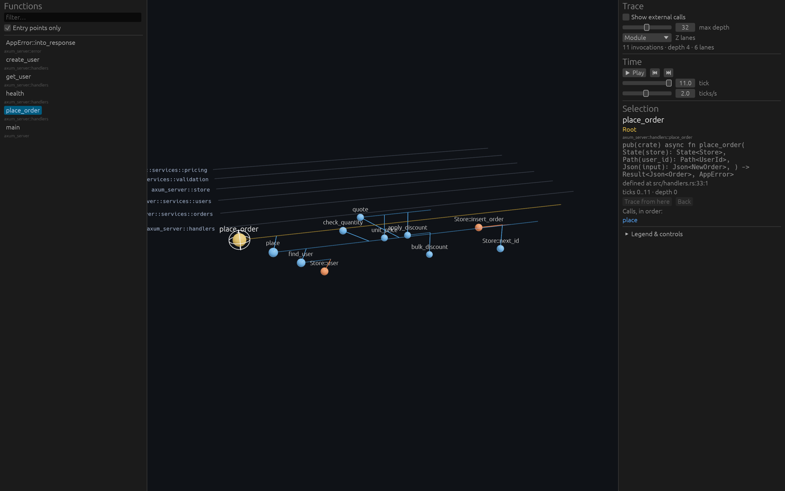

# codeviz

Explore a Rust codebase's call flow in 3D. Point it at a directory, pick a function
(an Axum handler, say), and follow everything it calls.



```sh
mise install
mise run demo                       # opens the viewer on demo/axum-server
cargo run -p codeviz -- <dir> --list
cargo run -p codeviz -- <dir> --entry users::register --print-trace
cargo run -p codeviz -- <dir> --entry users::register --screenshot out.png
```

Controls: left-drag orbit, right-drag pan, scroll zoom. `←`/`→` step through calls in
time, `↑` jumps to the caller, `↓` to the first callee, `F` focuses the selection,
`Space` plays the trace, `Enter` re-roots on the selection, `Backspace` goes back.

## The picture

Each node is one invocation in a static trace unrolled from the chosen root.

- **X — time.** A logical clock that ticks once per call, depth-first in evaluation
  order. A caller's lifeline spans every call it makes, transitively.
- **Y — stack depth.** Callees hang below their callers.
- **Z — lanes.** Module by default; switchable to file, impl type, or flat. Calls that
  cross a layer boundary jump between planes.

Colors distinguish exact resolution, name-based inference (method calls on receivers
of unknown type), ambiguous matches, external calls, and truncated recursion.

## Workspace

| Crate | Role |
| --- | --- |
| `codeviz-graph` | Language-agnostic call graph model and trace expansion. No I/O. |
| `codeviz-rust` | Rust frontend: package discovery, tree-sitter extraction, name resolution. |
| `codeviz-layout` | Maps a trace onto 3D coordinates. Renderer-agnostic. |
| `codeviz-viewer` | Bevy + egui viewer. |
| `codeviz` | CLI binary. |
| `demo/axum-server` | Layered Axum service used as a fixture. |

Dependencies point one way: frontends and the layout depend on `codeviz-graph`; the
viewer depends on graph and layout; only the CLI knows about the Rust frontend.

## Limits of syntactic resolution

There is no type information. Method calls on anything other than `self` are matched
by name across the analyzed source; calls into trait impls of external traits are not
matched by name. Capitalized call targets are treated as constructors and dropped.
Trait-object and generic dispatch, re-exports via `pub use`, and macro-generated items
are not modeled.
